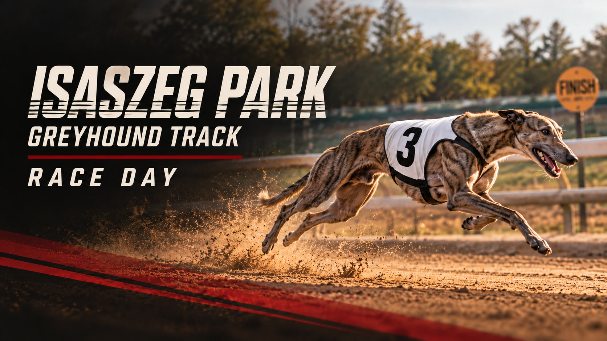

# isaszeg-park

**Isaszeg Replay** is an offline desktop replay desk and audience monitor for Isaszeg Park. Select clips from the camera card, import them into a dated race-day folder, and keep races, track banners and sponsor ads playing on the second screen.

This is the initial implementation. Camera codecs, actual removable-card detection and two physical monitors must be checked on the track computer before using it at a meeting.



## Race-day workflow

1. Connect the audience monitor and choose **Extend these displays** in Windows Display Settings. Launch Isaszeg Replay on the operator screen.
2. The app opens today's race day, using Europe/Budapest time. Change the date to reopen a previous meeting.
3. Select the audience monitor and click **Open display**. The audience window goes fullscreen; the operator keeps the controls.
4. Insert the SD card. When the mounted drive appears, the importer opens. Open its camera folder (often `DCIM`) and select the recording. **Browse folder** and **Select files directly** are always available.
5. Check the proposed race number and click **Import selected**. The app copies and verifies the recording, then appends it to the loop. The current replay continues without restarting. Remove the card only after import completes.
6. Use **Latest race** to play the newest imported recording immediately. **Hold banner** stays on the welcome slide until you select a clip or press Next. Import the next race whenever it is ready.

Files are stored under `Documents/Isaszeg Replay/YYYY-MM-DD/` by default. Each meeting has a plain `meeting.json` file and its copied media. Race files use readable names such as `race-01-a1b2c3d4.mp4`; the suffix prevents collisions. Originals on the camera card are never renamed or deleted. Change the storage root in Settings to an external disk if needed. Back up the entire root folder regularly.

## Run from source

Install [Node.js 24 LTS](https://nodejs.org/), then in this repository:

```sh
npm ci
npm start
```

No server or internet connection is needed during normal operation. The operator UI, player and artwork are bundled locally. Development dependency installation needs internet access.

On Windows, after installing Node.js 24, you can also double-click `Start-Isaszeg-Replay.cmd`. It installs dependencies on the first launch and starts the app.

For a quick interface demo without Electron:

```sh
npm run demo
```

Open `http://127.0.0.1:4173/`. In the browser demo, files are temporary for that tab, SD detection and saved folders are unavailable, and the audience window mirrors the operator preview. Use the desktop app at the track.

## Windows, macOS and Linux builds

The **Test and build desktop apps** GitHub Actions workflow creates Windows installer and portable `.exe` files, macOS `.dmg` / `.zip`, and Linux `.AppImage`. Open the repository's **Actions** tab, select a successful run, and download the artifact for your OS. Extract the artifact ZIP before running the installer or portable application. Builds are unsigned; code signing is a deployment follow-up.

To package locally, run `npm run dist` on the target OS. Platform-specific commands are `npm run dist:win`, `npm run dist:mac` and `npm run dist:linux`. Prefer the build matrix for all three platforms; macOS signing requires macOS.

## Races and dogs

Use **Races & dogs** to register race cards and dogs, assign traps, record optional results, and match recordings by race number. **Open reference meeting** loads the scraped CGRC European Derby finals (4 October 2026: 14 races, 75 entries) without replacing existing registration. The first three races identify the supplied local video references. Desktop registration is saved with the meeting; browser registration persists on this device. See [registration workflow and source notes](docs/REGISTRATION.md).

## Controls

| Action | Shortcut |
| --- | --- |
| Play / pause | Space |
| Skip racecard reading time (keep the one-second transition) | Enter |
| Back / forward five seconds | Left / Right arrow |
| Quarter / half / three-quarter / normal speed | 1 / 2 / 3 / 4 |
| Cycle playback speeds | S |
| Previous / next playlist item | P / N |
| Play latest enabled race | R |
| Hold the welcome banner | B |
| Audience fullscreen | F |
| Show shortcut guide (operator window) | ? |

Shortcuts work while either app window has keyboard focus. They do not take over other applications, text inputs or operator dialogs. Blackout pauses playback and covers the audience screen; click Blackout again to restore it.

## Banners and sponsor slots

The welcome banner uses gentle motion. The race desk has separate **Videos & banners** and **Sponsor playlist** panels, each with playback, ordering, enable, edit and removal controls. Sponsor content rotates between races at the configured interval. Manage track images or video banners in **Banners**, and sponsor images and videos in **Sponsors**. Each view has one add button in the page header. **Add sponsor content** imports directly into the sponsor collection; the ordinary media importer offers race recordings and banners.

Use the trash button beside a playlist item or **Remove** in its Banners or Sponsors section, then confirm **Remove from meeting**. Removal is saved for that meeting; archived media files and camera originals are kept. Removing the current item switches playback to available content, with the welcome banner as a fallback when the loop is empty. Playback uses `object-fit: contain`: the full recording remains visible. Race recordings fill the display with transparent runner overlays; the optional sponsor footer appears below videos, banners and sponsor content, reserving space without covering the recording or runner overlays.

Two generated sponsor mockups are included: Connolly's RED MILLS and PEDRO, based on names visible in the supplied track photos. Both are labelled **MOCK AD · CONCEPT ONLY**, start disabled, and require appropriate sponsor review before real use. They contain no product or nutrition claims. Enable your own production ads through the same workflow. The scheduler inserts ads after the configured number of races and ensures each enabled creative receives a slot in every loop.

Track colors supplied by the operator are recorded in [docs/ART-DIRECTION.md](docs/ART-DIRECTION.md) and `src/shared/traps.mjs`. **Race numbers and trap numbers are different.** Trap 3 is a white jacket with black 3; trap 6 is black-and-white horizontal stripes with red 6.

## Reliability and limits

- Imports are serialized, staged to `.part` files, hashed with SHA-256, verified against the written copy and added to the manifest only after success. Identical content is skipped even if renamed. Failed imports do not enter the playlist; source files remain untouched.
- The displayed clip is retained when another clip is appended. One renderer owns playback; the operator preview is a muted mirror, so it never doubles the audio.
- A disconnected audience monitor hides output and prompts the operator to select it again. Playback errors skip failed items after notifying the operator; the welcome banner remains available. No frame-accurate judging or photo-finish functionality is provided.
- H.264 / AVC video in an MP4 container is the recommended camera format. MOV, M4V and WebM can be selected, but support depends on the codecs inside. HEVC / H.265 and unusual camera formats may need conversion before import. Slow playback does not synthesize new frames.
- Windows polls removable drives and fixed-type readers containing `DCIM`; macOS checks `/Volumes`; Linux checks `/media` and `/run/media` mounts. Some readers or corporate PowerShell policies require manual Browse. The app detects mounted drives, not camera hardware directly.
- Media and settings are local. No analytics, cloud account, upload, streaming or auto-update service is included. Electron renderers use a sandbox, isolated context, a restricted preload bridge and a local media protocol. Remote network requests are blocked in the desktop session.
- Closing the operator window exits the application. Hiding the audience window keeps the loop running. The app prevents display sleep while running.

## Development

```sh
npm test
npm run check
```

Tests cover verified imports, source preservation, duplicate detection, failure isolation, numbering, concurrent imports, meeting separation, corrupt manifests, local dates, playlist scheduling, keyboard guards, uninterrupted playback updates, slow rates, pause, blackout and holding behavior. The separate `npm run test:desktop` smoke test exercises real Electron windows, IPC, H.264 decoding and importing; on Linux it needs a display or `xvfb-run -a npm run test:desktop`. That test is configured in the build workflow but cannot run in a restricted container that cannot launch Chromium. Architecture and the physical-machine acceptance checklist are in [docs/OPERATIONS.md](docs/OPERATIONS.md).

The original repository was created by its owner. This project preserves that initial history. No open-source license has been selected; the sponsor artwork is conceptual, and third-party marks remain the property of their owners.
